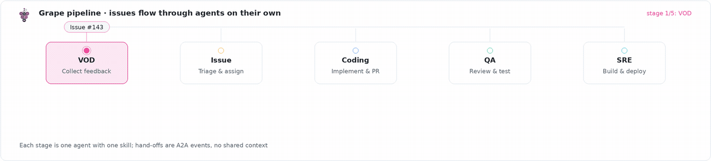
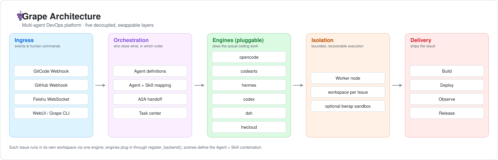

<div align="center">
  

  <h1>Grape</h1>

  <p>
    <strong>AI Native DevOps —— Turn Any Git Project into an AI-Driven Development Workflow with One Click</strong>
    <br>
    No IDE required. Design, develop, test, and ship anywhere, anytime.
  </p>

  <p>
    <a href="LICENSE"></a>
    <a href="https://github.com/grape-dev/grape/tree/main"></a>
    <a href="https://www.grapedev.cn/"></a>
    
    
    
    <a href="README.zh.md"></a>
  </p>

  <p>
    <a href="https://www.grapedev.cn/app/">▶ Try it live</a> ·
    <a href="#quick-install">Quick Install</a> ·
    <a href="#install-with-your-ai-agent">Let an AI Agent install it</a> ·
    <a href="docs/">Docs</a> ·
    <a href="examples/">Examples</a> ·
    <a href="CONTRIBUTING.md">Contributing</a> ·
    <a href="README.zh.md">中文</a>
  </p>

  <sub>VOD Agent → Issue Agent → Coding Agent → QA Agent → SRE Agent</sub>
</div>



---

## Table of Contents

- [Why Grape](#why-grape) · [Core Values](#core-values) · [What is Grape](#what-is-grape)
- [Architecture](#architecture) · [Core Capabilities](#core-capabilities) · [Scenarios](#scenarios)
- [Quick Install](#quick-install) · [Install with your AI Agent](#install-with-your-ai-agent) · [First 10 Minutes](#first-10-minutes)
- [Deployment](#deployment) · [Database](#database) · [Configuration](#configuration) · [Docs & Examples](#docs--examples)
- [Contributing](#contributing) · [Community & Feedback](#community--feedback)
- [Security](#security) · [License](#license)

---

## Why Grape

Traditional DevOps relies heavily on manual effort across the pipeline: Issues need manual triage, code needs developers to write, PRs need human review, builds and deployments need manual triggers. More projects, more overhead.

Grape's goal is to **AI-ify every one of these steps**, turning developers from executors into decision-makers — you define the direction, AI handles the rest.

| Stage | Traditional | Grape AI Native |
|-------|-----------|-----------------|
| Issue Triage | Manual classification & assignment | VOD / Issue Agent auto-classify & assign |
| Implementation | Developer writes code | Coding Agent auto-implements & submits PR |
| Code Review | Human review | QA Agent auto-review & security scan |
| Build & Deploy | Manual / CI trigger | SRE Agent auto-build, deploy, monitor |
| Requirements | Manual feedback collection | VOD Agent gathers developer voice, clusters insights |

## Core Values

Grape redefines the software development workflow — no longer "human-driven with AI assistance", but "AI-driven, human-reviewed".

| # | Core Value |
|---|-----------|
| **1** | **One-Click AI Hosting, Autonomous Evolution** — Connect any Git project to Grape, and the full pipeline from requirements to delivery is driven by Multi-Agent handoff. Issues auto-triage, code auto-implemented, PRs auto-reviewed, builds auto-deployed. |
| **2** | **No IDE, Anywhere Full-Stack R&D** — Feishu or WebUI becomes your development interface. Design, develop, test, ship — no editor required. |
| **3** | **Open Source as Templates, Instant Experience & Customization** — Every open-source project in the community is your starting template. One-click creation, auto-deployment for experience, Skill-driven customization — an AI development workflow from 0 to 1. |

## What is Grape

Grape is a Multi-Agent DevOps platform where AI Agents autonomously collaborate to handle every repetitive step of the development workflow. Connect a traditional Git project to Grape and it instantly gains a complete AI-native workflow — from requirements clarification, code implementation, review and verification, to build and deployment.

**In one sentence: turn your Git project into an AI-driven autonomous development team.**

---

## Architecture



| Layer | Components | Responsibility |
|-------|-----------|----------------|
| **Entry** | GitCode Webhook · GitHub Webhook · Feishu WebSocket · WebUI / CLI | Receives events and human instructions |
| **Orchestration** | Agent definitions · Agent × Skill mapping · A2A handoff · Task Center | Decides who does what, in what order |
| **Engine** | `opencode` / `codearts` / `hermes` / `codex` / `dsh` / `hwcloud` (pluggable, `register_backend`) | Executes the actual coding work |
| **Isolation** | Worker node · workspace per issue · optional bwrap sandbox | Keeps execution bounded and recoverable |
| **Delivery** | Build · deploy · monitor · release management | Ships the result |

Key directories: `src/` (service & agents) · `configs/` (bot tokens, agent seeds, mappings, engine selection) · `scenes/` (dev scenarios) · `scripts/` (ops, sync and check scripts) · `help/` (API & developer docs) · `docs/` (design & review docs). The official skill library is **not** committed here — it is pulled in from [grape-skills](https://github.com/grape-dev/grape-skills) at deploy time.

---

## Core Capabilities

### Multi-Agent Workflow

Once connected, every Issue / PR event is handled by a pipeline of Agents:

```
VOD Agent → Issue Agent → Coding Agent → QA Agent → SRE Agent
 Voice      Requirements    Implementation   Review       Build & Deploy
```

| Agent type | Role | Sub-scenes |
|---|---|---|
| **VOD Agent** | Collects developer feedback, clusters insights, auto-creates Issues | feedback-loop |
| **Issue Agent** | Classifies, labels, assigns, triggers Coding over A2A | feedback-loop |
| **Coding Agent** | Code implementation, PR creation, self-review | scaffolding · ai-coding-review · app-release |
| **QA Agent** | PR review, automated testing, security checks | auto-testing · code-quality |
| **SRE Agent** | Build & deployment, release management, monitoring | app-release · ci · container-deploy · log-diagnostics · observability |
| **Chat Agent** | Personal assistant via Feishu or WebUI | im |

Agents collaborate through the **A2A protocol** (`POST /api/a2a`), with each task flowing end-to-end automatically. Coding and QA do not watch PR events directly — they only run when an upstream Agent hands off, which keeps the chain deterministic.

### One-Click AI Native

```
Choose a template / existing Git project
  → One-click create & host
  → Auto-apply dev scenario (Agent × Skill mapping)
  → Async onboarding (analyze project, create experience & exploration Issues)
  → Every Issue / PR from that point on is handled by the Multi-Agent pipeline
```

### Skills Library

Skills are Markdown-only playbooks that tell an Agent *how* to do a kind of work; the Agent type decides *who* does it. 60+ registered skills cover the full lifecycle:

| Agent type | Registered skills | What they cover |
|---|---:|---|
| VOD | 11 | Feedback collection, insight clustering, Issue authoring |
| Issue | 10 | Triage, labeling, assignment, handoff |
| Coding | 12 | Scaffolding, implementation, self-review, release prep |
| QA | 12 | Test planning, automated testing, security checks |
| SRE | 17 | Build, deploy, rollback, monitoring, troubleshooting |
| Chat | 3 | IM assistant flows |

Layout is a three-level convention — `skills/<agent_type>/<sub_scene>/<skill>/SKILL.md`, optionally with `references/`, `scripts/` and `templates/`. This tree is not committed to this repo: the official skills come from [grape-skills](https://github.com/grape-dev/grape-skills) and are mounted at deploy time. Custom skills can be uploaded at official / repo / user level and are configured per repository.

The official library lives in its own repo, [grape-skills](https://github.com/grape-dev/grape-skills), and is pulled into the deployment root by `scripts/sync_skills.sh`.

### Execution Engines

At least one engine CLI must be installed. All six are registered in `src/agent/executor.py` and are selectable per agent / per scene / per repo; new ones can be added with `register_backend()`.

| Backend | CLI | Install |
|---|---|---|
| `opencode` | `opencode` | `npm install -g opencode` |
| `codearts` | `codearts` | `pip install codearts-cli` |
| `hermes` | `hermes` | `pip install hermes` |
| `codex` | `codex` | `npm install -g @openai/codex` |
| `dsh` | `dsh` | `npm install -g @deepseek-ai/dsh` |
| `hwcloud` | `hwcloud` | Huawei Cloud KooCLI |

`python scripts/doctor.py` reports which engine CLIs are present on the host (currently it probes `opencode` / `codearts`; the other four are detected by the platform at runtime). The Runtimes page shows a live per-engine probe — status, latency, last probe — and `GET /api/dashboard/ops/probe-now` forces a fresh probe round.

### Supported Entry Points

| Entry | Method | Description |
|-------|--------|-------------|
| GitCode | HTTP Webhook (`/webhook/gitcode`) | Issue / PR / comment / build / deploy events |
| GitHub | HTTP Webhook (`/webhook/github`) | Same event set for GitHub-hosted repos |
| Feishu | WebSocket long-lived | Multi-bot isolation, 100+ bots supported |
| WebUI | SPA | Dashboard · Pipeline · Events · Issues · Agents · Runtimes · Skills · Scene Market · Templates · Knowledge · Feedback · Observability · Autopilot · Organizations · Settings |
| CLI | `grape` | Same operations from the terminal, for agents and headless hosts. Ships as a **separate package** — [grape-dev/grape-cli](https://gitcode.com/grape-dev/grape-cli) (`pip install git+https://gitcode.com/grape-dev/grape-cli.git`); commands are generated from the OpenAPI contract, so every documented API is a subcommand |

### Other Features

- **Multi-bot Feishu** — 100+ bots isolated in a single process, hot-reload, auto-reconnect
- **GitCode ↔ Feishu User Mapping** — P2P identity confirmation binding
- **Multi-tenant** — GitCode / GitHub OAuth login with whitelist, per-user credential isolation
- **Event Audit** — Every Agent execution traced (logs, duration, conclusion), Pipeline visualization
- **Scene Marketplace** — Scenes are data, not code: `scene.json` defines the node graph and the skills each node mounts
- **IM abstraction** — `src/im/base.py` defines a channel interface (Feishu today; WeCom / DingTalk slots reserved)

---

## Scenarios

Grape ships ready-made development scenarios (Agent × Skill mappings) under `scenes/`. Pick one at project creation, or write your own mapping in `configs/agent-skill-mapping.json`.

| Scene | Category | What it is for |
|---|---|---|
| `default` | general | End-to-end development, requirements → deploy. Fits most projects |
| `agent-dev` | ai | Building agents and multi-agent applications |
| `blog-publish` | content | Content pipeline: topic → AI draft → auto-publish |
| `cloud-native` | iac | Microservices and containerised workloads |
| `cloud-native-cli` | iac | Same as above, driven entirely through the `grape` CLI |
| `iac` | iac | Infrastructure as code with Terraform |
| `huawei-skill` | skill-dev | Building and publishing Huawei Cloud skill packages |
| `common-skill-dev` | skill-dev | Building skills on the Grape skill framework |
| `common-restapi-skill-dev` | skill-dev | Skill development against a standard REST API |
| `grape-skill-dev` | skill-dev | Generating or reworking skills to the Grape spec |

Each scene carries a `recommended_template`, so "create project" can be one click from an empty account.

---

## Quick Install

### Prerequisites

| Component | Requirement | Notes |
|-----------|-------------|-------|
| **Python** | **>= 3.10 (required)** | The main service uses modern type annotations/syntax. Below 3.10 the process prints an explicit message and exits *before* importing any business module — so a 3.9 environment fails fast and loudly, not with a confusing syntax error |
| **Node.js** | >= 18 (for the Agent CLI) | `npm install -g opencode` |
| **Git** | Any recent version | |
| **Docker** | Optional | For the compose quick look |

> **Docker (quickest look)**

```bash
export JWT_SECRET=$(openssl rand -hex 32)
# docker-compose.yml declares ${JWT_SECRET:?JWT_SECRET required} — without it the container exits immediately
docker compose up -d
# WebUI: http://<host>/   (compose maps 80:3000 and 8080:3000)
# Health: curl -fsS http://127.0.0.1:3000/api/health
```

> **Local run (from source)**

```bash
git clone https://github.com/grape-dev/grape.git && cd grape
python3 -m venv .venv && source .venv/bin/activate   # Windows: .\.venv\Scripts\Activate.ps1
pip install -r requirements-local.txt                # minimal set (no OBS/MySQL/Feishu)
# pip install -r requirements.txt                    # full set
cp .env.example .env && mkdir -p data
python -m src.api.run --dev                          # http://localhost:3000
```

<details>
<summary><b>Windows one-click setup (PowerShell)</b></summary>

```powershell
.\start.ps1                 # Local dev (minimal deps, SQLite)
.\start.ps1 -Full           # Full deps (OBS/MySQL/Feishu)
.\start.ps1 -SkipDoctor     # Skip preflight, just start
```
If PowerShell blocks script execution: `Set-ExecutionPolicy -ExecutionPolicy RemoteSigned -Scope CurrentUser`
</details>

<details>
<summary><b>China mirror &amp; network tips (国内镜像加速)</b></summary>

```bash
pip install -r requirements-local.txt -i https://mirrors.aliyun.com/pypi/simple/
# or permanently:
pip config set global.index-url https://mirrors.aliyun.com/pypi/simple/
```

Occasional HTTP/2 frame errors or timeouts during `git fetch` are network jitter — the fetch path retries up to 3 times with backoff. If it still fails, fall back to HTTP/1.1 or route through a mirror:

```bash
git config --global http.version HTTP/1.1
git config --global url."https://<your-mirror>/https://github.com/".insteadOf "https://github.com/"
```
</details>

<details>
<summary><b>Install an execution engine (at least one)</b></summary>

```bash
npm install -g opencode       # Node.js based (reference engine)
# or
pip install codearts-cli      # Python based
# see the Execution Engines table for the other four
```
</details>

### Zero configuration to try it

Either start path above (Docker or source — see "Local run (from source)") needs **no `configs/` setup at all**: clone, start, done. Then **sign up with a username and password** right in the WebUI — no OAuth needed for local use:

- With no email service configured, registration skips the email verification code (put any placeholder in the email field — it is not validated), and you are signed in as soon as the account is created;
- With no GitCode / GitHub OAuth configured, the login page says "register and sign in with username + password"; the third-party buttons are greyed out but local accounts work normally;
- Project templates take care of themselves: `examples/` ships with only a README, and **on first start the platform pulls the template library from [grape-template](https://github.com/grape-dev/grape-template)** (watch for `Templates: ... verified OK` in the startup log).

To exercise the full pipeline (Issue → Coding → PR → deploy), install one execution engine: `npm install -g opencode`.

### Configuration needed before production

Once you want to serve others (OAuth login, repo hosting, Feishu), these files matter. All are gitignored.

**1. Public base URL** — `configs/server-config.json` (skippable for local use)

```bash
cp configs/server-config.example.json configs/server-config.json
```

```jsonc
{
  "server_base_url": "https://<your-domain>",
  "webhook_url": "https://<your-domain>/webhook/gitcode"
}
```

Skip it for a single-machine trial: the service falls back to `http://localhost:3000`, and since you are browsing from that same machine there is no callback problem at all. As soon as others need to reach it, or OAuth login is enabled, it becomes mandatory — otherwise OAuth callbacks point at the local machine, GitCode/GitHub cannot reach back, and login/hosting fail. Startup logs and `GET /api/health` surface an explicit `server_base_url_configured=false` warning.

**2. OAuth app credentials (optional)** — `configs/oauth-providers.json`

```bash
cp configs/oauth-providers.example.json configs/oauth-providers.json
```

```jsonc
{
  "gitcode": {
    "client_id": "<your GitCode OAuth App Client ID>",
    "client_secret": "<your GitCode OAuth App Client Secret>",
    "redirect_uri": "https://<your-domain>/api/auth/callback/gitcode",
    "auth_url": "https://gitcode.com/oauth/authorize",
    "token_url": "https://gitcode.com/oauth/token",
    "user_url": "https://gitcode.com/api/v5/user",
    "scope": "all"
  },
  "github": {
    "client_id": "<your GitHub OAuth App Client ID>",
    "client_secret": "<your GitHub OAuth App Client Secret>",
    "redirect_uri": "https://<your-domain>/api/auth/callback/github",
    "auth_url": "https://github.com/login/oauth/authorize",
    "token_url": "https://github.com/login/oauth/access_token",
    "user_url": "https://api.github.com/user",
    "scope": "repo user admin:repo_hook offline_access"
  }
}
```

`configs/oauth-providers.json` is only a **seed**: it is imported into the database idempotently on startup, and everything is read from the DB at runtime — **the DB is authoritative** — so change these later in the admin console (Config Center → Platform Credentials); editing the file will not overwrite existing values. The `redirect_uri` here must exactly match the callback URL registered in the OAuth App. Credentials in the wrong file, or with empty fields, make `/api/auth/login/{provider}` return 400 `not_configured`. (Legacy OAuth fields in `configs/global-bot-token.json` are still read for backward compatibility; use `oauth-providers.json` for new setups.)

**What if you skip it?** You only lose "sign in with a GitCode / GitHub account" and repo hosting; local accounts, scenes, skills and the pipeline all work normally. And when you do want OAuth, you can fill client_id / client_secret in the admin console (`http://<host>/admin`) after startup instead of coming back to this file.

**3. Bot credentials (only for GitCode / Feishu integration)** — `configs/global-bot-token.json`

```bash
cp configs/global-bot-token.example.json configs/global-bot-token.json
# then fill in the GitCode / Feishu bot credentials
```

<details>
<summary><b>Preflight check</b></summary>

```bash
python scripts/doctor.py     # environment preflight: Python/Node/Git, engine CLIs, config files
```

The full staged checklist — every operation, its expected result, and the fix for each failure mode — is in
[docs/0-to-1-checklist.md](docs/0-to-1-checklist.md).
</details>

---

## Install with your AI Agent

Paste the following to your coding agent (Claude Code / Codex / Cursor / opencode …) and it will set everything up for you:

```text
Install Grape (AI Native DevOps) from https://github.com/grape-dev/grape and get it running:

  git clone https://github.com/grape-dev/grape.git && cd grape
  python3 -m venv .venv && source .venv/bin/activate && pip install -r requirements-local.txt
  cp .env.example .env && mkdir -p data && python -m src.api.run --dev

This is local-trial mode: no OAuth, email or database configuration needed. Also install one engine CLI
(npm install -g opencode), run scripts/doctor.py, and verify GET http://localhost:3000/api/health returns 200.
Then open http://localhost:3000 and use "Register" to create a local username/password account
(with no mail service the verification code step is skipped).
Report each step's outcome; on failure show the exact command and error output. Repo conventions: CONTRIBUTING.md.
```

---

## First 10 Minutes

Getting the service to start is step one. This is what "it's actually working" looks like. **The default path is a local account — no OAuth anywhere in it.**

1. **Register a local account and sign in** — open `http://<host>/`, click **Register**, and create an account with a username and password (with no mail service configured the email verification step is skipped and the account is created right away). Getting in proves the service is up. Want GitCode / GitHub login instead? See step 6.
2. **Create a project** — choose a template from `examples/` or host an existing Git repo, and pick a scene (see [Scenarios](#scenarios)). Hosting needs platform credentials (step 6) first; for a pure local trial you can also create an empty project and try a scene on it.
3. **Watch onboarding** — Grape analyses the project asynchronously and opens an experience/exploration Issue. That Issue going through the pipeline end-to-end is the real smoke test.
4. **Check the pipeline view** — every agent hop, its skill, duration and conclusion is on the Pipeline page. If a hop failed, the reason is there, not in a log file.
5. **Bind Feishu (optional)** — add a bot, then confirm the GitCode ↔ Feishu identity mapping; from then on you can drive the pipeline from chat.
6. **Only when you want third-party login / repo hosting: configure OAuth (optional)** — open the admin console at `http://<host>/admin` (separate login; the first deploy seeds `admin` / `admin123`, changeable via `GRAPE_ADMIN_PASSWORD` before first start, and you are prompted to change the password on first login). Under **Config Center → Platform Credentials** fill the GitCode OAuth client_id / client_secret, bot token and webhook URL; **saving takes effect immediately** because values go to the database, which is authoritative. The whitelist lives under **User Management → OAuth Login Whitelist**, **off by default** (and an empty list lets everyone in even when on); tighten it there rather than in `configs/login-whitelist.json` (imported once, on first start, only if the table is empty).
   The one thing the console does not manage is the OAuth **callback URL**: it comes from `server_base_url` / `webhook_url` in `configs/server-config.json` and must match the OAuth App registration.

> A 400 `not_configured` can only appear when you actually use a third-party login — then check **Platform Credentials** in the console for an empty client_id / secret. A callback URL mismatch means `configs/server-config.json` still points at localhost. A whitelist block is a rejection, not a 400 — check the toggle and list in the console. Local account login is unaffected by all three.

---

## Deployment

```bash
python -m src.api.run          # Production: main API 3000 + Webhook 8080
python -m src.api.run --dev    # Development: single port 3000, hot-reload
```

Production deployment examples (nginx reverse proxy / systemd / Docker) live in `docs/` (see `docs/DOCUMENTATION-GUIDE.md`); the compose file and `nginx-grape.conf` are at the repo root. Alert rules ship in `deploy/alerts.yml`.

### Database

**SQLite by default — nothing to install.** Tables are created on first start, the database file is `data/sessions.db` (change the path with `DEVOPS_DB_PATH`); under Docker it lives in the `grape-data` volume, and `docker compose down -v` deletes that volume along with all state.

Backend resolution order: `DEVOPS_DB_BACKEND` env var > `backend` field in `configs/db-backend.json` > `sqlite` (restart required).

For production, switch to **MySQL 8.x** in three steps:

```bash
# 1. Install the driver (in requirements.txt; not in the minimal requirements-local.txt)
pip install pymysql DBUtils

# 2. Create the database — Grape creates tables, never the database itself; the charset must be utf8mb4 or CJK/emoji text breaks
mysql -h<host> -u<user> -p -e "CREATE DATABASE IF NOT EXISTS grape_db CHARACTER SET utf8mb4 COLLATE utf8mb4_general_ci;"
```

```json
// 3. configs/db-backend.json (copy from db-backend.example.json)
{
  "backend": "mysql",
  "mysql": {
    "host": "<db-host>",
    "port": 3306,
    "user": "<user>",
    "password": "<password>",
    "database": "grape_db"
  }
}
```

The `DEVOPS_DB_HOST` / `DEVOPS_DB_PORT` / `DEVOPS_DB_USER` / `DEVOPS_DB_PASSWORD` / `DEVOPS_DB_NAME` env vars override that file (preferred for containers and clusters), or use a single URL: `DEVOPS_DB_URL=mysql://<user>:<password>@<host>:3306/grape_db`. Defaults for anything unset: host `127.0.0.1`, port `3306`, user `grape`, database `grape_db`.

**No manual table creation, no migration runs**: startup issues `CREATE TABLE IF NOT EXISTS` plus idempotent `ALTER` migrations; for SQLite the old file is backed up to `data/backups/` before a migration (latest 5 kept, tunable via `DB_BACKUP_KEEP`). Verify with `curl -fsS http://127.0.0.1:3000/api/health` and the startup line `MySQLCompatDB: connection pool initialized (min=2, max_cached=16, max_conn=32)`.

<details markdown="1">
<summary>Production notes and common failures</summary>

- The database account needs `CREATE` / `ALTER` / `INDEX` on that database — table creation and migrations run automatically at startup.
- Pool sizing is env-driven: `DB_POOL_MIN` (2) / `DB_POOL_MAX_CACHED` (16) / `DB_POOL_MAX_CONNECTIONS` (32); `DB_POOL_DISABLED=1` falls back to the legacy per-thread connection.
- MySQL 8 defaults to `caching_sha2_password`: `pymysql` with `cryptography` (already pulled in by `python-jose[cryptography]`) completes the handshake; if it still fails, create the account with `mysql_native_password`.
- The admin console reads its featured-order list from a separate admin database (default `grape_admin_db`, overridable via `ADMIN_DB_*`): if unreachable it degrades silently and does not affect the main flow.
- `docker-compose.yml` starts the app only, **no MySQL service**; for Docker + MySQL point the config at an external instance (`./configs` is mounted into the container — restart the container after editing).
- Switching backends does not move data: existing SQLite data must be migrated by hand (the repo only ships `scripts/export_mysql_to_sqlite.py`, the MySQL → SQLite direction).
- Failure cheat sheet: `ModuleNotFoundError: pymysql` → driver missing; `Access denied` → wrong account, grants or database name; garbled CJK text → database is not `utf8mb4`; data "disappears" after a restart → still on SQLite and the `grape-data` volume was removed by `down -v`.

</details>

### Configuration

`copy` = not in this repo, copy it from the matching `.example.json` before first start. `synced` = produced at deploy time by the sync scripts. `committed` = version-controlled here.

| File | Source | Description |
|------|--------|-------------|
| `configs/server-config.json` | copy | Skippable for a local trial; required when serving others. Public base URL (`server_base_url` / `webhook_url`); without it OAuth callbacks point at localhost |
| `configs/oauth-providers.json` | copy | Optional — only needed for third-party login or repo hosting. Seeds the GitCode / GitHub OAuth credentials into the DB at startup; maintain them in the console (Platform Credentials) afterwards. `redirect_uri` must match the OAuth App exactly |
| `configs/global-bot-token.json` | copy | Global bot token + legacy OAuth fields |
| `configs/login-whitelist.json` | copy | Optional. Seed for the GitCode login whitelist — imported once on first start, only when the table is empty; the console (OAuth Login Whitelist) owns it afterwards |
| `configs/db-backend.json` | copy | Database backend (SQLite by default; MySQL 8.x recommended for production — see Database below) |
| `configs/agent-description.json` | committed | Agent type seeds (event subscriptions, default engine) |
| `configs/agent-skill-mapping.json` | committed | Dev scenario → Agent × Skill mapping |
| `configs/engine-selection.json` | committed | Which engine runs which agent; no silent fallback to `opencode` when unset |
| `configs/skill-description.json` | synced | Skill registry, from [grape-skills](https://github.com/grape-dev/grape-skills) via `scripts/sync_skills.sh` |
| `configs/project-templates.json` | synced | Project template registry, from [grape-template](https://github.com/grape-dev/grape-template) via `scripts/sync_templates.sh`; template dirs land in `examples/` |

## Docs & Examples

| Path | Contents |
|---|---|
| `help/api/` | REST API reference, one file per domain (auth, repos, agents, chat, skills, scenes, events, issues, A2A, runtime …). The OpenAPI spec is served live by a running instance at `/openapi.json` |
| `help/developer/` | Integration guides: GitCode, GitHub, IM bots, storage & email, database & sync |
| `help/usage/`, `help/reference/` | Usage walkthroughs and event-mapping reference |
| `docs/` | Design, review and debugging documents (see `docs/DOCUMENTATION-GUIDE.md` first) |
| `examples/` | Project template library, populated at deploy time by `scripts/sync_templates.sh` from [grape-template](https://github.com/grape-dev/grape-template) — `hello-*` starters plus full apps (snake-game, alien-invasion, hello-blog-sys …). The repo itself ships only the registry README |

---

## Contributing

1. **Open an Issue** — Describe what you want to do or the problem you've found
2. **Fork & Develop** — Fork the repo, work on a feature branch
3. **Add Tests** — Include pytest tests for new/modified features
4. **Submit a PR** — Describe changes, test results, and linked Issue

### Branch Naming

| Prefix | Purpose |
|--------|---------|
| `feat/` | New features |
| `fix/` | Bug fixes |
| `refactor/` | Code refactoring (no behavior change) |
| `docs/` | Documentation |
| `chore/` | Build, tooling |

### Non-code Contributions Welcome

- **Documentation** — Improve README, supplement design docs, fix typos
- **Skills** — Contribute new Agent skills to [grape-skills](https://github.com/grape-dev/grape-skills) (`skills/<agent_type>/<sub_scene>/<skill>/SKILL.md`, Markdown only, no backend changes)
- **Templates** — Add project templates to [grape-template](https://github.com/grape-dev/grape-template)
- **Bug Reports** — Clear repro steps, environment info, logs
- **Test Cases** — Coverage for edge cases
- **Community** — Answer questions, write tutorials

See [CONTRIBUTING.md](CONTRIBUTING.md) for the full guide — the branch model, commit-message convention and Friday release process. Looking for a first task? Check issues labeled `good first issue`.

## Community & Feedback

- **Issues** — https://github.com/grape-dev/grape/issues (bugs: include environment, repro steps, logs)
- **Feishu** — feedback directly in your bound group chat after connecting Grape
- **Discussions / 社群** — official community channel link to be added

**If Grape is useful to you, a ⭐ Star helps other developers find it** — and it tells us which direction to invest in next.

## Security

See [SECURITY.md](SECURITY.md) for the vulnerability reporting process and the security model of Agent execution. Anything under `docs/` must respect `docs/DOCUMENTATION-GUIDE.md` — no real IPs, domains, accounts or credentials.

## License

MIT — see [LICENSE](LICENSE).

## Star History

<a href="https://star-history.com/#grape-dev/grape&Date">
  
</a>