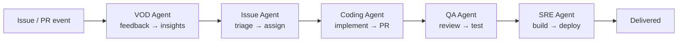

<div align="center">
  

  <h1>Grape</h1>

  <p>
    <strong>AI Native DevOps —— Turn Any Git Project into an AI-Driven Development Workflow with One Click</strong>
    <br>
    No IDE required. Design, develop, test, and ship anywhere, anytime.
  </p>

  <p>
    <a href="LICENSE"></a>
    <a href="https://github.com/grape-dev/grape/releases"></a>
    <a href="https://github.com/grape-dev/grape/actions/workflows/windows-smoke.yml"></a>
    
    <a href="README.zh.md"></a>
  </p>

  <p>
    <a href="https://www.grapedev.cn/app/">▶ Try it live</a> ·
    <a href="#quick-install">Quick Install</a> ·
    <a href="#install-with-your-ai-agent">Let an AI Agent install it</a> ·
    <a href="docs/">Docs</a> ·
    <a href="examples/">Examples</a> ·
    <a href="CONTRIBUTING.md">Contributing</a> ·
    <a href="README.zh.md">中文</a>
  </p>

  <sub>VOD Agent → Issue Agent → Coding Agent → QA Agent → SRE Agent</sub>
</div>



> `assets/pipeline-flow.gif` (the animated walkthrough) is not committed yet — the diagram above renders everywhere in the meantime.

---

## Table of Contents

- [Why Grape](#why-grape) · [Core Values](#core-values) · [What is Grape](#what-is-grape)
- [Architecture](#architecture) · [Core Capabilities](#core-capabilities) · [Scenarios](#scenarios)
- [Quick Install](#quick-install) · [Install with your AI Agent](#install-with-your-ai-agent) · [First 10 Minutes](#first-10-minutes)
- [Deployment](#deployment) · [Configuration](#configuration) · [Docs & Examples](#docs--examples)
- [Roadmap](#roadmap) · [Contributing](#contributing) · [Community & Feedback](#community--feedback)
- [Security](#security) · [License](#license)

---

## Why Grape

Traditional DevOps relies heavily on manual effort across the pipeline: Issues need manual triage, code needs developers to write, PRs need human review, builds and deployments need manual triggers. More projects, more overhead.

Grape's goal is to **AI-ify every one of these steps**, turning developers from executors into decision-makers — you define the direction, AI handles the rest.

| Stage | Traditional | Grape AI Native |
|-------|-----------|-----------------|
| Issue Triage | Manual classification & assignment | VOD / Issue Agent auto-classify & assign |
| Implementation | Developer writes code | Coding Agent auto-implements & submits PR |
| Code Review | Human review | QA Agent auto-review & security scan |
| Build & Deploy | Manual / CI trigger | SRE Agent auto-build, deploy, monitor |
| Requirements | Manual feedback collection | VOD Agent gathers developer voice, clusters insights |

## Core Values

Grape redefines the software development workflow — no longer "human-driven with AI assistance", but "AI-driven, human-reviewed".

| # | Core Value |
|---|-----------|
| **1** | **One-Click AI Hosting, Autonomous Evolution** — Connect any Git project to Grape, and the full pipeline from requirements to delivery is driven by Multi-Agent handoff. Issues auto-triage, code auto-implemented, PRs auto-reviewed, builds auto-deployed. |
| **2** | **No IDE, Anywhere Full-Stack R&D** — Feishu or WebUI becomes your development interface. Design, develop, test, ship — no editor required. |
| **3** | **Open Source as Templates, Instant Experience & Customization** — Every open-source project in the community is your starting template. One-click creation, auto-deployment for experience, Skill-driven customization — an AI development workflow from 0 to 1. |

## What is Grape

Grape is a Multi-Agent DevOps platform where AI Agents autonomously collaborate to handle every repetitive step of the development workflow. Connect a traditional Git project to Grape and it instantly gains a complete AI-native workflow — from requirements clarification, code implementation, review and verification, to build and deployment.

**In one sentence: turn your Git project into an AI-driven autonomous development team.**

---

## Architecture

```mermaid
flowchart LR
  subgraph E["Entry"]
    A1[GitCode Webhook]
    A2[GitHub Webhook]
    A3[Feishu Long Connection]
    A4[WebUI / Grape CLI]
  end
  subgraph O["Orchestration"]
    B1[Agent definitions]
    B2[Agent x Skill mapping]
    B3[A2A handoff]
    B4[Task Center]
  end
  subgraph X["Engine (pluggable)"]
    C1[opencode]
    C2[codearts]
    C3[hermes]
    C4[codex]
    C5[dsh]
    C6[hwcloud]
  end
  subgraph I["Isolation"]
    D1[Worker nodes]
    D2[Workspace per issue]
    D3[bwrap sandbox]
  end
  E --> O --> X --> I --> F["Delivery: build / deploy / monitor / release"]
```



| Layer | Components | Responsibility |
|-------|-----------|----------------|
| **Entry** | GitCode Webhook · GitHub Webhook · Feishu WebSocket · WebUI / CLI | Receives events and human instructions |
| **Orchestration** | Agent definitions · Agent × Skill mapping · A2A handoff · Task Center | Decides who does what, in what order |
| **Engine** | `opencode` / `codearts` / `hermes` / `codex` / `dsh` / `hwcloud` (pluggable, `register_backend`) | Executes the actual coding work |
| **Isolation** | Worker node · workspace per issue · optional bwrap sandbox | Keeps execution bounded and recoverable |
| **Delivery** | Build · deploy · monitor · release management | Ships the result |

Key directories: `src/` (service & agents) · `configs/` (bot tokens, agent seeds, mappings, engine selection) · `scenes/` (dev scenarios) · `scripts/` (ops, sync and check scripts) · `help/` (API & developer docs) · `docs/` (design & review docs). The official skill library is **not** committed here — it is pulled in from [grape-skills](https://github.com/grape-dev/grape-skills) at deploy time.

---

## Core Capabilities

### Multi-Agent Workflow

Once connected, every Issue / PR event is handled by a pipeline of Agents:

```
VOD Agent → Issue Agent → Coding Agent → QA Agent → SRE Agent
 Voice      Requirements    Implementation   Review       Build & Deploy
```

| Agent type | Role | Sub-scenes |
|---|---|---|
| **VOD Agent** | Collects developer feedback, clusters insights, auto-creates Issues | feedback-loop |
| **Issue Agent** | Classifies, labels, assigns, triggers Coding over A2A | feedback-loop |
| **Coding Agent** | Code implementation, PR creation, self-review | scaffolding · ai-coding-review · app-release |
| **QA Agent** | PR review, automated testing, security checks | auto-testing · code-quality |
| **SRE Agent** | Build & deployment, release management, monitoring | app-release · ci · container-deploy · log-diagnostics · observability |
| **Chat Agent** | Personal assistant via Feishu or WebUI | im |

Agents collaborate through the **A2A protocol** (`POST /api/a2a`), with each task flowing end-to-end automatically. Coding and QA do not watch PR events directly — they only run when an upstream Agent hands off, which keeps the chain deterministic.

### One-Click AI Native

```
Choose a template / existing Git project
  → One-click create & host
  → Auto-apply dev scenario (Agent × Skill mapping)
  → Async onboarding (analyze project, create experience & exploration Issues)
  → Every Issue / PR from that point on is handled by the Multi-Agent pipeline
```

### Skills Library

Skills are Markdown-only playbooks that tell an Agent *how* to do a kind of work; the Agent type decides *who* does it. 60+ registered skills cover the full lifecycle:

| Agent type | Registered skills | What they cover |
|---|---:|---|
| VOD | 11 | Feedback collection, insight clustering, Issue authoring |
| Issue | 10 | Triage, labeling, assignment, handoff |
| Coding | 12 | Scaffolding, implementation, self-review, release prep |
| QA | 12 | Test planning, automated testing, security checks |
| SRE | 17 | Build, deploy, rollback, monitoring, troubleshooting |
| Chat | 3 | IM assistant flows |

Layout is a three-level convention — `skills/<agent_type>/<sub_scene>/<skill>/SKILL.md`, optionally with `references/`, `scripts/` and `templates/`. This tree is not committed to this repo: the official skills come from [grape-skills](https://github.com/grape-dev/grape-skills) and are mounted at deploy time. Custom skills can be uploaded at official / repo / user level and are configured per repository.

The official library lives in its own repo, [grape-skills](https://github.com/grape-dev/grape-skills), and is pulled into the deployment root by `scripts/sync_skills.sh`.

### Execution Engines

At least one engine CLI must be installed. All six are registered in `src/agent/executor.py` and are selectable per agent / per scene / per repo; new ones can be added with `register_backend()`.

| Backend | CLI | Install |
|---|---|---|
| `opencode` | `opencode` | `npm install -g opencode` |
| `codearts` | `codearts` | `pip install codearts-cli` |
| `hermes` | `hermes` | `pip install hermes` |
| `codex` | `codex` | `npm install -g @openai/codex` |
| `dsh` | `dsh` | `npm install -g @deepseek-ai/dsh` |
| `hwcloud` | `hwcloud` | Huawei Cloud KooCLI |

`python scripts/doctor.py` reports which engine CLIs are present on the host (currently it probes `opencode` / `codearts`; the other four are detected by the platform at runtime). The Runtimes page shows a live per-engine probe — status, latency, last probe — and `GET /api/dashboard/ops/probe-now` forces a fresh probe round.

### Supported Entry Points

| Entry | Method | Description |
|-------|--------|-------------|
| GitCode | HTTP Webhook (`/webhook/gitcode`) | Issue / PR / comment / build / deploy events |
| GitHub | HTTP Webhook (`/webhook/github`) | Same event set for GitHub-hosted repos |
| Feishu | WebSocket long-lived | Multi-bot isolation, 100+ bots supported |
| WebUI | SPA | Dashboard · Pipeline · Events · Issues · Agents · Runtimes · Skills · Scene Market · Templates · Knowledge · Feedback · Observability · Autopilot · Organizations · Settings |
| CLI | `grape` | Same operations from the terminal, for agents and headless hosts. Ships as a **separate package** — [grape-dev/grape-cli](https://gitcode.com/grape-dev/grape-cli) (`pip install git+https://gitcode.com/grape-dev/grape-cli.git`); commands are generated from the OpenAPI contract, so every documented API is a subcommand |

### Other Features

- **Multi-bot Feishu** — 100+ bots isolated in a single process, hot-reload, auto-reconnect
- **GitCode ↔ Feishu User Mapping** — P2P identity confirmation binding
- **Multi-tenant** — GitCode / GitHub OAuth login with whitelist, per-user credential isolation
- **Event Audit** — Every Agent execution traced (logs, duration, conclusion), Pipeline visualization
- **Scene Marketplace** — Scenes are data, not code: `scene.json` defines the node graph and the skills each node mounts
- **IM abstraction** — `src/im/base.py` defines a channel interface (Feishu today; WeCom / DingTalk slots reserved)

---

## Scenarios

Grape ships ready-made development scenarios (Agent × Skill mappings) under `scenes/`. Pick one at project creation, or write your own mapping in `configs/agent-skill-mapping.json`.

| Scene | Category | What it is for |
|---|---|---|
| `default` | general | End-to-end development, requirements → deploy. Fits most projects |
| `agent-dev` | ai | Building agents and multi-agent applications |
| `blog-publish` | content | Content pipeline: topic → AI draft → auto-publish |
| `cloud-native` | iac | Microservices and containerised workloads |
| `cloud-native-cli` | iac | Same as above, driven entirely through the `grape` CLI |
| `iac` | iac | Infrastructure as code with Terraform |
| `huawei-skill` | skill-dev | Building and publishing Huawei Cloud skill packages |
| `common-skill-dev` | skill-dev | Building skills on the Grape skill framework |
| `common-restapi-skill-dev` | skill-dev | Skill development against a standard REST API |
| `grape-skill-dev` | skill-dev | Generating or reworking skills to the Grape spec |

Each scene carries a `recommended_template`, so "create project" can be one click from an empty account.

---

## Quick Install

### Prerequisites

| Component | Requirement | Notes |
|-----------|-------------|-------|
| **Python** | **>= 3.10 (required)** | The main service uses modern type annotations/syntax. Below 3.10 the process prints an explicit message and exits *before* importing any business module — so a 3.9 environment fails fast and loudly, not with a confusing syntax error |
| **Node.js** | >= 18 (for the Agent CLI) | `npm install -g opencode` |
| **Git** | Any recent version | |
| **Docker** | Optional | For the compose quick look |

> **Docker (quickest look)**

```bash
export JWT_SECRET=$(openssl rand -hex 32)
# docker-compose.yml declares ${JWT_SECRET:?JWT_SECRET required} — without it the container exits immediately
docker compose up -d
# WebUI: http://<host>/   (compose maps 80:3000 and 8080:3000)
# Health: curl -fsS http://127.0.0.1:3000/api/health
```

> **Local run (from source)**

```bash
git clone https://github.com/grape-dev/grape.git && cd grape
python3 -m venv .venv && source .venv/bin/activate   # Windows: .\.venv\Scripts\Activate.ps1
pip install -r requirements-local.txt                # minimal set (no OBS/MySQL/Feishu)
# pip install -r requirements.txt                    # full set
cp .env.example .env && mkdir -p data
python -m src.api.run --dev                          # http://localhost:3000
```

<details>
<summary><b>Windows one-click setup (PowerShell)</b></summary>

```powershell
.\start.ps1                 # Local dev (minimal deps, SQLite)
.\start.ps1 -Full           # Full deps (OBS/MySQL/Feishu)
.\start.ps1 -SkipDoctor     # Skip preflight, just start
```
If PowerShell blocks script execution: `Set-ExecutionPolicy -ExecutionPolicy RemoteSigned -Scope CurrentUser`
</details>

<details>
<summary><b>China mirror &amp; network tips (国内镜像加速)</b></summary>

```bash
pip install -r requirements-local.txt -i https://mirrors.aliyun.com/pypi/simple/
# or permanently:
pip config set global.index-url https://mirrors.aliyun.com/pypi/simple/
```

Occasional HTTP/2 frame errors or timeouts during `git fetch` are network jitter — the fetch path retries up to 3 times with backoff. If it still fails, fall back to HTTP/1.1 or route through a mirror:

```bash
git config --global http.version HTTP/1.1
git config --global url."https://<your-mirror>/https://github.com/".insteadOf "https://github.com/"
```
</details>

<details>
<summary><b>Install an execution engine (at least one)</b></summary>

```bash
npm install -g opencode       # Node.js based (reference engine)
# or
pip install codearts-cli      # Python based
# see the Execution Engines table for the other four
```
</details>

### Required configuration

Two files **must** be created before OAuth login or repo hosting will work. Neither is optional in a real deployment, and both are gitignored.

**1. Public base URL** — `configs/server-config.json`

```bash
cp configs/server-config.example.json configs/server-config.json
```

```jsonc
{
  "server_base_url": "https://<your-domain>",
  "webhook_url": "https://<your-domain>/webhook/gitcode"
}
```

Without it the service falls back to `http://localhost:3000`: OAuth callbacks point at the local machine, GitCode/GitHub cannot reach back, and login/hosting silently fails. Startup logs and `GET /api/health` surface an explicit `server_base_url_configured=false` warning.

**2. OAuth app credentials** — `configs/oauth-providers.json`

```bash
cp configs/oauth-providers.example.json configs/oauth-providers.json
```

```jsonc
{
  "gitcode": {
    "client_id": "<your GitCode OAuth App Client ID>",
    "client_secret": "<your GitCode OAuth App Client Secret>",
    "redirect_uri": "https://<your-domain>/api/auth/callback/gitcode",
    "auth_url": "https://gitcode.com/oauth/authorize",
    "token_url": "https://gitcode.com/oauth/token",
    "user_url": "https://gitcode.com/api/v5/user",
    "scope": "all"
  },
  "github": {
    "client_id": "<your GitHub OAuth App Client ID>",
    "client_secret": "<your GitHub OAuth App Client Secret>",
    "redirect_uri": "https://<your-domain>/api/auth/callback/github",
    "auth_url": "https://github.com/login/oauth/authorize",
    "token_url": "https://github.com/login/oauth/access_token",
    "user_url": "https://api.github.com/user",
    "scope": "repo user admin:repo_hook offline_access"
  }
}
```

`configs/oauth-providers.json` is the authoritative OAuth credential file — it is synced into the DB on startup, idempotently. The `redirect_uri` here must exactly match the callback URL registered in the OAuth App. Credentials in the wrong file, or with empty fields, make `/api/auth/login/{provider}` return 400 `not_configured`. (Legacy OAuth fields in `configs/global-bot-token.json` are still read for backward compatibility; use `oauth-providers.json` for new setups.)

**3. Bot credentials** — `configs/global-bot-token.json`

```bash
cp configs/global-bot-token.example.json configs/global-bot-token.json
# then fill in the GitCode / Feishu bot credentials
```

<details>
<summary><b>Preflight check</b></summary>

```bash
python scripts/doctor.py     # environment preflight: Python/Node/Git, engine CLIs, config files
```

The full staged checklist — every operation, its expected result, and the fix for each failure mode — is in
[docs/0-to-1-checklist.md](docs/0-to-1-checklist.md).
</details>

---

## Install with your AI Agent

Paste the following to your coding agent (Claude Code / Codex / Cursor / opencode …) and it will set everything up for you:

```text
Install Grape (AI Native DevOps) from https://github.com/grape-dev/grape:

  git clone https://github.com/grape-dev/grape.git && cd grape
  python3 -m venv .venv && source .venv/bin/activate && pip install -r requirements-local.txt
  cp .env.example .env && mkdir -p data && python -m src.api.run --dev

Then: create configs/server-config.json and configs/oauth-providers.json from their .example files,
install one engine CLI (npm install -g opencode), run scripts/doctor.py,
and verify GET http://localhost:3000/api/health. Check commands are in CONTRIBUTING.md.
Report each step's outcome; on failure show the exact command and error output.
```

> For attaching a **Worker node** (remote execution machine) instead, generate a token in the Workers page of your Grape instance, then follow the installer printed there.

---

## First 10 Minutes

Getting the service to start is step one. This is what "it's actually working" looks like:

1. **Log in** — open the WebUI (`http://<host>/`), sign in with GitCode. Accounts must be in `configs/login-whitelist.json`; a successful login proves `server_base_url` and the OAuth credentials are both correct.
2. **Create a project** — choose a template from `examples/` or host an existing Git repo, and pick a scene (see [Scenarios](#scenarios)). Hosting writes the Grape webhook into the repo for you.
3. **Watch onboarding** — Grape analyses the project asynchronously and opens an experience/exploration Issue. That Issue going through the pipeline end-to-end is the real smoke test.
4. **Bind Feishu (optional)** — add a bot, then confirm the GitCode ↔ Feishu identity mapping; from then on you can drive the pipeline from chat.
5. **Check the pipeline view** — every agent hop, its skill, duration and conclusion is on the Pipeline page. If a hop failed, the reason is there, not in a log file.

> If step 1 fails with a 400, it is almost always `configs/oauth-providers.json` (field mismatch) or `configs/server-config.json` (still pointing at localhost) — check those two before anything else.

---

## Deployment

```bash
python -m src.api.run          # Production: main API 3000 + Webhook 8080
python -m src.api.run --dev    # Development: single port 3000, hot-reload
```

Production deployment examples (nginx reverse proxy / systemd / Docker) live in `docs/` (see `docs/DOCUMENTATION-GUIDE.md`); the compose file and `nginx-grape.conf` are at the repo root. Alert rules ship in `deploy/alerts.yml`.

### Configuration

`copy` = not in this repo, copy it from the matching `.example.json` before first start. `synced` = produced at deploy time by the sync scripts. `committed` = version-controlled here.

| File | Source | Description |
|------|--------|-------------|
| `configs/server-config.json` | copy | **Required.** Public base URL (`server_base_url` / `webhook_url`); without it OAuth callbacks point at localhost |
| `configs/oauth-providers.json` | copy | **Required.** OAuth app credentials for GitCode / GitHub. Must exactly match the callback URL registered in the OAuth App |
| `configs/global-bot-token.json` | copy | Global bot token + legacy OAuth fields |
| `configs/login-whitelist.json` | copy | GitCode login whitelist |
| `configs/db-backend.json` | copy | Database backend (SQLite by default, MySQL / OBS for production) |
| `configs/agent-description.json` | committed | Agent type seeds (event subscriptions, default engine) |
| `configs/agent-skill-mapping.json` | committed | Dev scenario → Agent × Skill mapping |
| `configs/engine-selection.json` | committed | Which engine runs which agent; no silent fallback to `opencode` when unset |
| `configs/skill-description.json` | synced | Skill registry, from [grape-skills](https://github.com/grape-dev/grape-skills) via `scripts/sync_skills.sh` |
| `configs/project-templates.json` | synced | Project template registry, from [grape-template](https://github.com/grape-dev/grape-template) via `scripts/sync_templates.sh`; template dirs land in `examples/` |

## Docs & Examples

| Path | Contents |
|---|---|
| `help/api/` | REST API reference, one file per domain (auth, repos, agents, chat, skills, scenes, events, issues, A2A, runtime …). The OpenAPI spec is served live by a running instance at `/openapi.json` |
| `help/developer/` | Integration guides: GitCode, GitHub, IM bots, storage & email, database & sync |
| `help/usage/`, `help/reference/` | Usage walkthroughs and event-mapping reference |
| `docs/` | Design, review and debugging documents (see `docs/DOCUMENTATION-GUIDE.md` first) |
| `examples/` | Project template library, populated at deploy time by `scripts/sync_templates.sh` from [grape-template](https://github.com/grape-dev/grape-template) — `hello-*` starters plus full apps (snake-game, alien-invasion, hello-blog-sys …). The repo itself ships only the registry README |

---

## Roadmap

| Item | Status | Notes |
|---|---|---|
| Sandbox hardening (on by default, tighter allowlists) | Planned | See the sandbox discussion in `docs/` |
| First-class Issue → PR timings | Planned | Emit `issue_created` / `pr_opened` timestamps so a real median can be reported |
| More execution engines | In progress | opencode / codearts / hermes / codex / dsh / hwcloud today |
| Preflight covers every engine | Planned | `scripts/doctor.py` currently probes `opencode` / `codearts` only |
| WeCom / DingTalk channels | Planned | The `src/im/base.py` channel interface is in place; only Feishu is wired today |
| Scene auto-continuation | Planned | Automatic hand-off when one stage of a scene finishes |
| More templates & scenarios | In progress | Contribute via `grape-template` / `grape-skills` |
| Documentation & onboarding | In progress | Examples, walkthroughs, i18n |
| GitCode / Gitee mirror experience | Planned | For users behind restricted GitHub access |

Want something on this list? Open an Issue — the roadmap is community-shaped.

---

## Contributing

1. **Open an Issue** — Describe what you want to do or the problem you've found
2. **Fork & Develop** — Fork the repo, work on a feature branch
3. **Add Tests** — Include pytest tests for new/modified features
4. **Submit a PR** — Describe changes, test results, and linked Issue

### Branch Naming

| Prefix | Purpose |
|--------|---------|
| `feat/` | New features |
| `fix/` | Bug fixes |
| `refactor/` | Code refactoring (no behavior change) |
| `docs/` | Documentation |
| `chore/` | Build, tooling |

### Non-code Contributions Welcome

- **Documentation** — Improve README, supplement design docs, fix typos
- **Skills** — Contribute new Agent skills to [grape-skills](https://github.com/grape-dev/grape-skills) (`skills/<agent_type>/<sub_scene>/<skill>/SKILL.md`, Markdown only, no backend changes)
- **Templates** — Add project templates to [grape-template](https://github.com/grape-dev/grape-template)
- **Bug Reports** — Clear repro steps, environment info, logs
- **Test Cases** — Coverage for edge cases
- **Community** — Answer questions, write tutorials

See [CONTRIBUTING.md](CONTRIBUTING.md) for the full guide — the branch model, commit-message convention and Friday release process. Looking for a first task? Check issues labeled `good first issue`.

## Community & Feedback

- **Issues** — https://github.com/grape-dev/grape/issues (bugs: include environment, repro steps, logs)
- **Feishu** — feedback directly in your bound group chat after connecting Grape
- **Discussions / 社群** — official community channel link to be added

**If Grape is useful to you, a ⭐ Star helps other developers find it** — and it tells us which direction to invest in next.

## Security

See [SECURITY.md](SECURITY.md) for the vulnerability reporting process and the security model of Agent execution. Anything under `docs/` must respect `docs/DOCUMENTATION-GUIDE.md` — no real IPs, domains, accounts or credentials.

## License

MIT — see [LICENSE](LICENSE).

## Star History

<a href="https://star-history.com/#grape-dev/grape&Date">
  
</a>