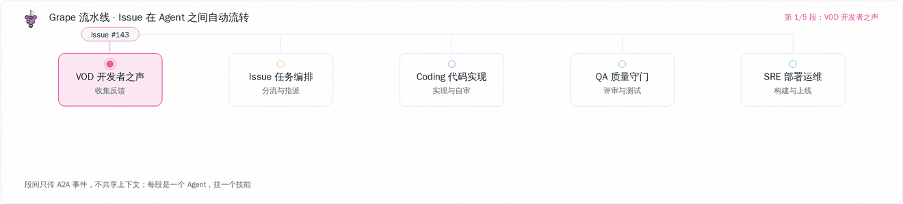
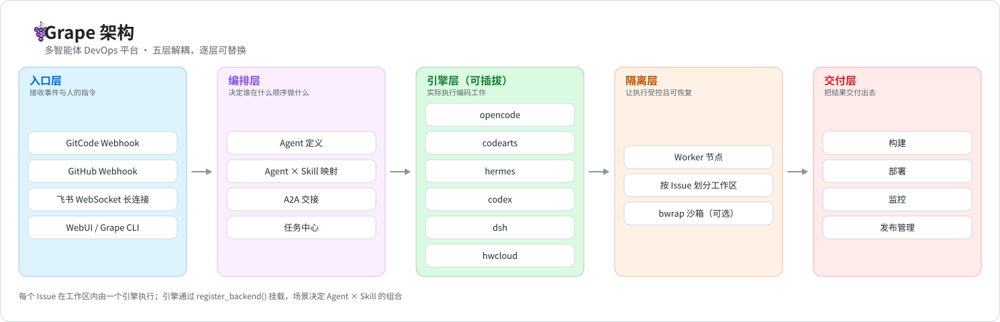

<div align="center">
  

  <h1>Grape</h1>

  <p>
    <strong>AI Native DevOps —— 一键把任意 Git 项目变成 AI 驱动的研发流水线</strong>
    <br>
    无需 IDE，随时随地设计、开发、测试、交付 —— 团队里每个人都能成为交付者。
  </p>

  <p>
    <a href="LICENSE"></a>
    <a href="https://github.com/grape-dev/grape/tree/main"></a>
    <a href="https://www.grapedev.cn/"></a>
    
    
    
    <a href="README.md"></a>
  </p>

  <p>
    <a href="https://www.grapedev.cn/app/">▶ 立即体验</a> ·
    <a href="#快速安装">快速安装</a> ·
    <a href="#让你的-ai-agent-自己装">让 Agent 自己装</a> ·
    <a href="docs/">文档</a> ·
    <a href="examples/">示例</a> ·
    <a href="CONTRIBUTING.md">参与贡献</a> ·
    <a href="README.md">English</a>
  </p>

  <sub>VOD Agent → Issue Agent → Coding Agent → QA Agent → SRE Agent</sub>
</div>



---

## 目录

- [为什么需要 Grape](#为什么需要-grape) · [核心价值](#核心价值) · [Grape 是什么](#grape-是什么)
- [架构](#架构) · [核心能力](#核心能力) · [开箱场景](#开箱场景)
- [快速安装](#快速安装) · [让你的 AI Agent 自己装](#让你的-ai-agent-自己装) · [上手 10 分钟](#上手-10-分钟)
- [部署](#部署) · [数据库](#数据库) · [配置](#配置) · [文档与示例](#文档与示例)
- [参与贡献](#参与贡献) · [社群与反馈](#社群与反馈)
- [安全](#安全) · [许可](#许可)

---

## 为什么需要 Grape

传统 DevOps 高度依赖人工：Issue 要人分类分派，代码要人写，PR 要人评审，构建部署要人触发。项目越多，人越不够用。

Grape 要做的是**把这些环节逐个 AI 化**，让开发者从"执行者"变成"决策者" —— 你定方向，AI 干活。

| 环节 | 传统方式 | Grape AI Native |
|-------|-----------|-----------------|
| Issue 分诊 | 人工分类、分派 | VOD / Issue Agent 自动分类分派 |
| 编码实现 | 开发者写代码 | Coding Agent 自动实现并提交 PR |
| 代码评审 | 人工评审 | QA Agent 自动评审 + 安全扫描 |
| 构建部署 | 手动 / CI 触发 | SRE Agent 自动构建、部署、监控 |
| 需求收集 | 人工收集反馈 | VOD Agent 汇聚开发者声音并聚类成洞察 |

## 核心价值

Grape 重新定义研发流程 —— 不是"人主导、AI 辅助"，而是"AI 驱动、人审核"。

| # | 核心价值 |
|---|-----------|
| **1** | **一键 AI 托管，自主进化** —— 任意 Git 项目接入 Grape，从需求到交付的全流程由多智能体交接驱动：Issue 自动分诊、代码自动实现、PR 自动评审、构建自动部署。 |
| **2** | **无 IDE，随时随地全栈研发** —— 飞书或 WebUI 就是你的开发界面，设计、开发、测试、交付全程不需要编辑器。 |
| **3** | **开源即模板，即刻体验与定制** —— 社区里的每个开源项目都是你的起手模板：一键创建、自动部署体验、技能驱动定制，AI 研发流程 0 到 1 即刻可用。 |

## Grape 是什么

Grape 是一个多智能体 DevOps 平台：AI Agent 之间自主协作，接管研发流程中每一个重复环节。把一个传统 Git 项目接入 Grape，它立刻获得一套完整的 AI 原生工作流 —— 从需求澄清、代码实现、评审验证，到构建与部署。

**一句话：把你的 Git 项目变成一支 AI 驱动的自主研发团队。**

---

## 架构



| 层 | 组件 | 职责 |
|-------|-----------|----------------|
| **入口层** | GitCode Webhook · GitHub Webhook · 飞书 WebSocket · WebUI / CLI | 接收事件与人的指令 |
| **编排层** | Agent 定义 · Agent × Skill 映射 · A2A 交接 · 任务中心 | 决定谁在什么顺序做什么 |
| **引擎层** | `opencode` / `codearts` / `hermes` / `codex` / `dsh` / `hwcloud`（可插拔，`register_backend`） | 实际执行编码工作 |
| **隔离层** | Worker 节点 · 按 Issue 划分的工作区 · 可选 bwrap 沙箱 | 让执行受控且可恢复 |
| **交付层** | 构建 · 部署 · 监控 · 发布管理 | 把结果交付出去 |

关键目录：`src/`（服务与 Agent）· `configs/`（机器人令牌、Agent 种子、映射、引擎选择）· `scenes/`（研发场景）· `scripts/`（运维、同步与检查脚本）· `help/`（API 与开发者文档）· `docs/`（设计与评审文档）。官方技能库**不在本仓** —— 部署时由 [grape-skills](https://github.com/grape-dev/grape-skills) 铺入。

---

## 核心能力

### 多智能体流水线

接入之后，每个 Issue / PR 事件都会由一串 Agent 接力处理：

```
VOD Agent → Issue Agent → Coding Agent → QA Agent → SRE Agent
 声音采集     需求分诊        编码实现       评审验证     构建部署
```

| Agent 类型 | 职责 | 子场景 |
|---|---|---|
| **VOD Agent** | 收集开发者反馈、聚类洞察、自动创建 Issue | feedback-loop |
| **Issue Agent** | 分类、打标、分派，并通过 A2A 触发编码 | feedback-loop |
| **Coding Agent** | 代码实现、创建 PR、自评审 | scaffolding · ai-coding-review · app-release |
| **QA Agent** | PR 评审、自动化测试、安全检查 | auto-testing · code-quality |
| **SRE Agent** | 构建与部署、发布管理、监控 | app-release · ci · container-deploy · log-diagnostics · observability |
| **Chat Agent** | 通过飞书或 WebUI 提供个人助理 | im |

Agent 之间通过 **A2A 协议**（`POST /api/a2a`）协作，任务端到端自动流转。Coding 与 QA 不直接监听 PR 事件，只在上游 Agent 交接时启动 —— 这让整条链路的触发是确定的，而不是靠事件互相抢。

### 一键 AI 原生

```
选择模板 / 已有 Git 项目
  → 一键创建并托管
  → 自动套用研发场景（Agent × Skill 映射）
  → 异步初始化（分析项目，创建体验与探索 Issue）
  → 此后每个 Issue / PR 都走多智能体流水线
```

### 技能库

技能是纯 Markdown 的"作业手册"，告诉 Agent **怎么做**某类工作；Agent 类型决定**谁来做**。已注册 60+ 技能，覆盖完整生命周期：

| Agent 类型 | 已注册技能数 | 覆盖内容 |
|---|---:|---|
| VOD | 11 | 反馈收集、洞察聚类、Issue 撰写 |
| Issue | 10 | 分诊、打标、分派、交接 |
| Coding | 12 | 脚手架、实现、自评审、发布准备 |
| QA | 12 | 测试设计、自动化测试、安全检查 |
| SRE | 17 | 构建、部署、回滚、监控、排障 |
| Chat | 3 | IM 助理流程 |

目录采用三级约定：`skills/<agent_type>/<sub_scene>/<skill>/SKILL.md`，可选带 `references/`、`scripts/` 与 `templates/`。这棵目录树不在本仓：官方技能由 [grape-skills](https://github.com/grape-dev/grape-skills) 提供，部署时挂载。自定义技能支持官方 / 仓库级 / 用户级上传，可按仓库配置。

官方技能库独立维护在 [grape-skills](https://github.com/grape-dev/grape-skills)，由 `scripts/sync_skills.sh` 在建包时同步到部署根目录。

### 执行引擎

至少需要安装一个引擎 CLI。六个引擎都注册在 `src/agent/executor.py`，可按 Agent / 场景 / 仓库分别选择；新增引擎通过 `register_backend()` 挂载。

| 引擎 | CLI | 安装方式 |
|---|---|---|
| `opencode` | `opencode` | `npm install -g opencode` |
| `codearts` | `codearts` | `pip install codearts-cli` |
| `hermes` | `hermes` | `pip install hermes` |
| `codex` | `codex` | `npm install -g @openai/codex` |
| `dsh` | `dsh` | `npm install -g @deepseek-ai/dsh` |
| `hwcloud` | `hwcloud` | 华为云 KooCLI |

`python scripts/doctor.py` 会报告主机上装了哪些引擎 CLI（当前只探测 `opencode` / `codearts`，其余四个由平台在运行时探测）。Runtimes 页面展示每个引擎的实时探测结果 —— 状态、延迟、上次探测时间，`GET /api/dashboard/ops/probe-now` 可强制触发一轮新探测。

### 支持的入口

| 入口 | 方式 | 说明 |
|-------|--------|-------------|
| GitCode | HTTP Webhook (`/webhook/gitcode`) | Issue / PR / 评论 / 构建 / 部署事件 |
| GitHub | HTTP Webhook (`/webhook/github`) | GitHub 托管仓库的同套事件 |
| 飞书 | WebSocket 长连接 | 多机器人隔离，支持 100+ 机器人 |
| WebUI | SPA | 看板 · 流水线 · 事件 · Issue · Agent · 运行时 · 技能 · 场景市场 · 模板 · 知识库 · 反馈 · 可观测 · 自动驾驶 · 组织 · 设置 |
| CLI | `grape` | 同样的操作可在终端完成，适合 Agent 与无界面主机。它是**独立发布的包** —— [grape-dev/grape-cli](https://gitcode.com/grape-dev/grape-cli)（`pip install git+https://gitcode.com/grape-dev/grape-cli.git`）；子命令由 OpenAPI 契约生成，接口文档里有的能力 CLI 里就有 |

### 其他特性

- **飞书多机器人** —— 单进程隔离 100+ 机器人，热加载、自动重连
- **GitCode ↔ 飞书用户映射** —— P2P 身份确认绑定
- **多租户** —— GitCode / GitHub OAuth 登录 + 白名单，用户间凭据隔离
- **事件审计** —— 每次 Agent 执行留痕（日志、耗时、结论），流水线可视化
- **场景市场** —— 场景即数据：`scene.json` 定义节点图以及每个节点挂载的技能
- **IM 通道抽象** —— `src/im/base.py` 定义了通道接口（当前实装飞书，企业微信 / 钉钉预留）

---

## 开箱场景

`scenes/` 下提供现成的研发场景（Agent × Skill 映射）。创建项目时选用其一，或自行在 `configs/agent-skill-mapping.json` 中编写映射。

| 场景 | 分类 | 适用 |
|---|---|---|
| `default` | general | 全链路开发，需求 → 部署，适合大多数项目 |
| `agent-dev` | ai | 构建智能体与多 Agent 应用 |
| `blog-publish` | content | 内容流水线：选题 → AI 成稿 → 自动发布 |
| `cloud-native` | iac | 微服务与容器化项目 |
| `cloud-native-cli` | iac | 同上，全程通过 `grape` CLI 操作 |
| `iac` | iac | 用 Terraform 管理云资源的基础设施即代码 |
| `huawei-skill` | skill-dev | 华为云技能包开发与发布 |
| `common-skill-dev` | skill-dev | 基于 Grape 技能框架开发技能 |
| `common-restapi-skill-dev` | skill-dev | 面向标准 REST API 的技能开发 |
| `grape-skill-dev` | skill-dev | 按 Grape 规范生成或改造技能 |

每个场景都带 `recommended_template`，所以"新建项目"在空账号下也能一键完成。

---

## 快速安装

### 前置要求

| 组件 | 要求 | 说明 |
|-----------|-------------|-------|
| **Python** | **>= 3.10（硬性要求）** | 主服务使用新式类型注解/语法。低于 3.10 时进程会在 import 任何业务模块**之前**显式提示并退出 —— 3.9 环境快速失败，而不是抛一个难排查的语法错误 |
| **Node.js** | >= 18（供引擎 CLI 使用） | `npm install -g opencode` |
| **Git** | 任意较新版本 | |
| **Docker** | 可选 | 用于 compose 快速体验 |

> **Docker（想先看看效果时推荐）**

```bash
export JWT_SECRET=$(openssl rand -hex 32)
# docker-compose.yml 声明了 ${JWT_SECRET:?JWT_SECRET required}，缺失时容器会立刻退出
docker compose up -d
# WebUI: http://<主机>/   （compose 映射 80:3000 与 8080:3000）
# 自检: curl -fsS http://127.0.0.1:3000/api/health
```

> **源码本地运行**

```bash
git clone https://github.com/grape-dev/grape.git && cd grape
python3 -m venv .venv && source .venv/bin/activate   # Windows: .\.venv\Scripts\Activate.ps1
pip install -r requirements-local.txt                # 最小依赖（不含 OBS/MySQL/飞书）
# pip install -r requirements.txt                    # 完整依赖
cp .env.example .env && mkdir -p data
python -m src.api.run --dev                          # http://localhost:3000
```

<details>
<summary><b>Windows 一键脚本（PowerShell）</b></summary>

```powershell
.\start.ps1                 # 本地开发（最小依赖、SQLite）
.\start.ps1 -Full           # 完整依赖（OBS/MySQL/飞书）
.\start.ps1 -SkipDoctor     # 跳过预检直接启动
```
若 PowerShell 阻止脚本执行：`Set-ExecutionPolicy -ExecutionPolicy RemoteSigned -Scope CurrentUser`
</details>

<details>
<summary><b>国内镜像加速与网络建议</b></summary>

```bash
pip install -r requirements-local.txt -i https://mirrors.aliyun.com/pypi/simple/
# 或永久配置：
pip config set global.index-url https://mirrors.aliyun.com/pypi/simple/
```

`git fetch` 偶发 HTTP/2 帧错误或连接超时属网络抖动，拉取路径已做最多 3 次退避重试。仍失败可降级 HTTP/1.1 或走镜像：

```bash
git config --global http.version HTTP/1.1
git config --global url."https://<你的镜像>/https://github.com/".insteadOf "https://github.com/"
```
</details>

<details>
<summary><b>安装至少一个执行引擎</b></summary>

```bash
npm install -g opencode       # 基于 Node.js（参考引擎）
# 或
pip install codearts-cli      # 基于 Python
# 其余四个见「执行引擎」表格
```
</details>

### 零配置即可体验

上面两种启动方式（Docker 或源码，见「源码本地运行」）**都不需要任何 `configs/` 配置**——克隆下来直接启动就能用。启动后在 WebUI 用**用户名 + 密码注册登录**即可，本地体验完全不需要 OAuth：

- 未配置邮箱服务时，注册会自动跳过邮箱验证码（邮箱栏填个占位地址即可，不做格式与真实性校验），注册成功即已登录；
- 未配置 GitCode / GitHub OAuth 时，登录页会提示"请使用用户名密码注册登录"，第三方登录按钮置灰但本地账号照常可用；
- 项目模板也不用你操心：`examples/` 克隆下来只有一份 README，**首次启动时平台会自动从 [grape-template](https://github.com/grape-dev/grape-template) 拉取模板库**（启动日志里的 `Templates: ... verified OK` 即为同步完成）。

要跑通完整的流水线（Issue → Coding → PR → 部署），再装一个执行引擎即可：`npm install -g opencode`。

### 生产部署前的三项配置

本地体验跑通后，要对外服务（OAuth 登录、仓库托管、飞书）时，以下文件才真正需要。都在 gitignore 中。

**1. 对外基址** —— `configs/server-config.json`（本地体验可跳过）

```bash
cp configs/server-config.example.json configs/server-config.json
```

```jsonc
{
  "server_base_url": "https://<your-domain>",
  "webhook_url": "https://<your-domain>/webhook/gitcode"
}
```

本地单机体验不用配：服务会回落到 `http://localhost:3000`，而你就是从这台机器访问，没有任何回调问题。一旦要给别人访问或启用 OAuth 登录，就必须配——否则 OAuth 回调指向本机，GitCode/GitHub 无法回访，登录与托管都会失败。启动日志与 `GET /api/health` 会显式给出 `server_base_url_configured=false` 告警。

**2. OAuth 应用凭据（可选）** —— `configs/oauth-providers.json`

```bash
cp configs/oauth-providers.example.json configs/oauth-providers.json
```

```jsonc
{
  "gitcode": {
    "client_id": "<你的 GitCode OAuth App Client ID>",
    "client_secret": "<你的 GitCode OAuth App Client Secret>",
    "redirect_uri": "https://<your-domain>/api/auth/callback/gitcode",
    "auth_url": "https://gitcode.com/oauth/authorize",
    "token_url": "https://gitcode.com/oauth/token",
    "user_url": "https://gitcode.com/api/v5/user",
    "scope": "all"
  },
  "github": {
    "client_id": "<你的 GitHub OAuth App Client ID>",
    "client_secret": "<你的 GitHub OAuth App Client Secret>",
    "redirect_uri": "https://<your-domain>/api/auth/callback/github",
    "auth_url": "https://github.com/login/oauth/authorize",
    "token_url": "https://github.com/login/oauth/access_token",
    "user_url": "https://api.github.com/user",
    "scope": "repo user admin:repo_hook offline_access"
  }
}
```

`configs/oauth-providers.json` 只是首启时的**种子**：启动时会把它幂等地导入数据库，而运行时一律从 DB 读，**DB 才是权威源**——所以之后要在管理台「配置中心 → 平台凭据」里改，改文件不会覆盖已有值。这里的 `redirect_uri` 必须与 OAuth App 中登记的回调地址完全一致。凭据写错文件或字段留空，会让 `/api/auth/login/{provider}` 返回 400 `not_configured`。（`configs/global-bot-token.json` 中的旧 OAuth 字段仍兼容读取，新部署请用 `oauth-providers.json`。）

**不配这一项会怎样？** 只是失去"用 GitCode / GitHub 账号登录"和托管仓库的能力，本地账号登录、场景、技能、流水线全都照常可用。真要用 OAuth 时，也可以在启动后进管理台 `http://<主机>/admin` 填 client_id / client_secret，不必回头改这份文件。

**3. 机器人凭据（接入 GitCode / 飞书 时才需要）** —— `configs/global-bot-token.json`

```bash
cp configs/global-bot-token.example.json configs/global-bot-token.json
# 再填入 GitCode / 飞书机器人凭据
```

<details>
<summary><b>环境预检</b></summary>

```bash
python scripts/doctor.py     # 检查 Python/Node/Git、引擎 CLI 与配置文件
```

完整的分阶段自检清单（每一步的操作、期望结果、失败排查）见
[docs/0-to-1-checklist.md](docs/0-to-1-checklist.md)。
</details>

---

## 让你的 AI Agent 自己装

把下面这段直接发给你常用的编码 Agent（Claude Code / Codex / Cursor / opencode …），它会自己完成安装：

```text
请从 https://github.com/grape-dev/grape 安装 Grape（AI Native DevOps 平台）并跑起来：

  git clone https://github.com/grape-dev/grape.git && cd grape
  python3 -m venv .venv && source .venv/bin/activate && pip install -r requirements-local.txt
  cp .env.example .env && mkdir -p data && python -m src.api.run --dev

这是本地体验模式，不需要配置 OAuth、邮箱或数据库；请再装一个引擎 CLI（npm install -g opencode），
然后运行 scripts/doctor.py，并验证 GET http://localhost:3000/api/health 返回 200。
启动后到 http://localhost:3000 用"注册账号"创建本地用户名密码账号（无邮件服务时会跳过验证码）。
每一步都要汇报结果；若失败请贴出确切命令与错误输出。仓库约定见 CONTRIBUTING.md。
```

---

## 上手 10 分钟

服务起来只是第一步，下面才是"它真的能跑"的样子。**默认走本地账号，全程不需要 OAuth**。

1. **注册本地账号并登录** —— 打开 `http://<主机>/`，点「注册账号」，用用户名 + 密码建号即可（没有配邮件服务时会自动跳过邮箱验证码，直接注册成功）。登录成功就说明服务是通的。想用 GitCode / GitHub 登录，看第 6 步。
2. **创建项目** —— 从 `examples/` 里挑一个模板，或托管已有的 Git 仓库，并选一个场景（见[开箱场景](#开箱场景)）。托管仓库需要先配好平台凭据（第 6 步）；纯本地体验也可直接建空项目试用场景。
3. **看初始化** —— Grape 会异步分析项目并开出一个体验/探索 Issue。这个 Issue 端到端跑完，就是真正的冒烟验收。
4. **看流水线视图** —— 每一次 Agent 交接、用的技能、耗时与结论都在 Pipeline 页。某一跳失败，原因就在那里，不用去翻日志文件。
5. **绑定飞书（可选）** —— 添加机器人并确认 GitCode ↔ 飞书身份映射，之后就能在群里驱动流水线。
6. **要用第三方登录 / 托管仓库时，再配 OAuth（可选）** —— 进管理台 `http://<主机>/admin`（跟用户界面分开登录，首次部署的账号是 `admin` / `admin123`，启动前设 `GRAPE_ADMIN_PASSWORD` 可改成别的，首次登录会提示改密）。「配置中心 → 平台凭据」里填 GitCode 的 OAuth client_id / client_secret、bot token、webhook 地址，**保存即生效**——它写进数据库，DB 是权威源。白名单在「用户管理 → OAuth 登录白名单」，**默认关闭**（表为空时即使开着也放行），要收紧就在这一页加用户名，不用碰 `configs/login-whitelist.json`（那份文件只在首次启动、表为空时导入一次）。
   唯一管不到的是 OAuth **回调地址**：它来自 `configs/server-config.json` 的 `server_base_url` / `webhook_url`，必须与 OAuth App 登记的一致。

> 登录报 400 `not_configured` 只有在**用了第三方登录**时才出现——那时去管理台「平台凭据」看 client_id / secret 是否为空；回调报地址不匹配，则是 `configs/server-config.json` 还指向 localhost。白名单拦人是被拒绝而非 400，去管理台看开关和名单。本地账号登录与这三者都无关。

---

## 部署

```bash
python -m src.api.run          # 生产：主 API 3000 + Webhook 8080
python -m src.api.run --dev    # 开发：单端口 3000，热加载
```

nginx 反向代理 / systemd / Docker 等生产部署示例见 `docs/`（先读 `docs/DOCUMENTATION-GUIDE.md`），compose 文件与 `nginx-grape.conf` 在仓库根目录，告警规则在 `deploy/alerts.yml`。

### 数据库

**默认 SQLite，什么都不用装** —— 首次启动自动建表，库文件是 `data/sessions.db`（`DEVOPS_DB_PATH` 可改路径）；Docker 部署时它落在 `grape-data` 卷里，`docker compose down -v` 会把卷一起删掉，状态全丢。

后端取值顺序：环境变量 `DEVOPS_DB_BACKEND` > `configs/db-backend.json` 的 `backend` 字段 > 默认 `sqlite`（重启生效）。

生产建议切 **MySQL 8.x**，三步：

```bash
# 1. 装驱动（requirements.txt 已含；最小依赖 requirements-local.txt 不含）
pip install pymysql DBUtils

# 2. 建库 —— 程序只管建表，不管建库；字符集必须 utf8mb4，否则中文与 emoji 乱码
mysql -h<host> -u<user> -p -e "CREATE DATABASE IF NOT EXISTS grape_db CHARACTER SET utf8mb4 COLLATE utf8mb4_general_ci;"
```

```json
// 3. configs/db-backend.json（复制自 db-backend.example.json）
{
  "backend": "mysql",
  "mysql": {
    "host": "<db-host>",
    "port": 3306,
    "user": "<user>",
    "password": "<password>",
    "database": "grape_db"
  }
}
```

环境变量 `DEVOPS_DB_HOST` / `DEVOPS_DB_PORT` / `DEVOPS_DB_USER` / `DEVOPS_DB_PASSWORD` / `DEVOPS_DB_NAME` 优先于该文件（容器与集群推荐走环境变量），也可用一条连接串 `DEVOPS_DB_URL=mysql://<user>:<password>@<host>:3306/grape_db`；未配的字段有默认值：host `127.0.0.1`、port `3306`、user `grape`、database `grape_db`。

**不用手工建表，也不用跑迁移**：启动时 `CREATE TABLE IF NOT EXISTS` 建表 + 幂等 `ALTER` 迁移；SQLite 会在迁移前把旧库备份到 `data/backups/`（默认保留最近 5 份，`DB_BACKUP_KEEP` 可调）。验证：`curl -fsS http://127.0.0.1:3000/api/health`，启动日志出现 `MySQLCompatDB: connection pool initialized (min=2, max_cached=16, max_conn=32)`。

<details markdown="1">
<summary>生产细节与常见故障</summary>

- 数据库账号需要该库的 `CREATE` / `ALTER` / `INDEX` 权限 —— 建表与迁移都在启动时自动做。
- 连接池参数用环境变量调：`DB_POOL_MIN`(2) / `DB_POOL_MAX_CACHED`(16) / `DB_POOL_MAX_CONNECTIONS`(32)；出问题可设 `DB_POOL_DISABLED=1` 回到每线程裸连接。
- MySQL 8 默认 `caching_sha2_password`：`pymysql` 配合 `cryptography`（随 `python-jose[cryptography]` 已在依赖里）即可握手；若仍失败，改用 `mysql_native_password` 建账号。
- 管理台的精选排序另读一个 admin 库（默认 `grape_admin_db`，`ADMIN_DB_*` 可覆盖）：连不上会静默降级，不影响主流程。
- `docker-compose.yml` 只起应用、**不含 MySQL 服务**；Docker + MySQL 要把配置指向外部实例（`./configs` 已挂载进容器，改完重启容器生效）。
- 切换后端不会自动搬数据：SQLite 上的历史数据要自行迁移（仓库只带 `scripts/export_mysql_to_sqlite.py` 这条 MySQL → SQLite 的反向导出）。
- 故障对照：`ModuleNotFoundError: pymysql` → 驱动没装；`Access denied` → 账号、授权或库名不对；中文乱码 → 库不是 `utf8mb4`；重启后数据"消失" → 仍在 SQLite 且 `grape-data` 卷被 `down -v` 删了。

</details>

### 配置

`拷贝` = 不在本仓，首次启动前从同名 `.example.json` 拷入。`同步` = 部署时由同步脚本生成。`随仓` = 本仓版本受控。

| 文件 | 来源 | 说明 |
|------|--------|-------------|
| `configs/server-config.json` | 拷贝 | 本地体验可跳过；对外服务时必配。对外基址（`server_base_url` / `webhook_url`），不配则 OAuth 回调指向 localhost |
| `configs/oauth-providers.json` | 拷贝 | 可选。GitCode / GitHub 的 OAuth 凭据种子（要用第三方登录或托管仓库才需要），启动时导入 DB；之后在管理台「平台凭据」维护。`redirect_uri` 须与 OAuth App 登记的回调地址一致 |
| `configs/global-bot-token.json` | 拷贝 | 全局机器人令牌 + 旧版 OAuth 字段 |
| `configs/login-whitelist.json` | 拷贝 | 可选。GitCode 登录白名单种子，仅在首次启动且表为空时导入一次；之后由管理台「OAuth 登录白名单」维护 |
| `configs/db-backend.json` | 拷贝 | 数据库后端（默认 SQLite，生产建议 MySQL 8.x —— 详见下文「数据库」） |
| `configs/agent-description.json` | 随仓 | Agent 类型种子（事件订阅、默认引擎） |
| `configs/agent-skill-mapping.json` | 随仓 | 研发场景 → Agent × Skill 映射 |
| `configs/engine-selection.json` | 随仓 | 哪个 Agent 用哪个引擎；未配置时不会静默回落 `opencode` |
| `configs/skill-description.json` | 同步 | 技能注册表，由 [grape-skills](https://github.com/grape-dev/grape-skills) 经 `scripts/sync_skills.sh` 生成 |
| `configs/project-templates.json` | 同步 | 项目模板注册表，由 [grape-template](https://github.com/grape-dev/grape-template) 经 `scripts/sync_templates.sh` 生成，模板目录落到 `examples/` |

## 文档与示例

| 路径 | 内容 |
|---|---|
| `help/api/` | REST API 文档，按域拆分（auth、repos、agents、chat、skills、scenes、events、issues、A2A、runtime …）。OpenAPI 规范由运行中的实例在 `/openapi.json` 实时提供 |
| `help/developer/` | 集成指南：GitCode、GitHub、IM 机器人、存储与邮件、数据库与同步 |
| `help/usage/`、`help/reference/` | 使用走查与事件映射参考 |
| `docs/` | 设计、评审与排障文档（请先读 `docs/DOCUMENTATION-GUIDE.md`） |
| `examples/` | 项目模板库，部署时由 `scripts/sync_templates.sh` 从 [grape-template](https://github.com/grape-dev/grape-template) 铺入 —— `hello-*` 起手项目与完整应用（snake-game、alien-invasion、hello-blog-sys …）。仓库本身只带这份注册表的 README |

---

## 参与贡献

1. **提 Issue** —— 说明你想做什么，或你发现了什么问题
2. **Fork 并开发** —— Fork 仓库，在功能分支上工作
3. **补测试** —— 为新增/修改的功能附上 pytest 测试
4. **提交 PR** —— 说明改动内容、测试结果与关联 Issue

### 分支命名

| 前缀 | 用途 |
|--------|---------|
| `feat/` | 新功能 |
| `fix/` | 缺陷修复 |
| `refactor/` | 重构（不改变行为） |
| `docs/` | 文档 |
| `chore/` | 构建、工具链 |

### 欢迎非代码贡献

- **文档** —— 完善 README、补充设计文档、修正错别字
- **技能** —— 向 [grape-skills](https://github.com/grape-dev/grape-skills) 贡献新技能（`skills/<agent_type>/<sub_scene>/<skill>/SKILL.md`，纯 Markdown，无需改后端）
- **模板** —— 向 [grape-template](https://github.com/grape-dev/grape-template) 贡献项目模板
- **缺陷报告** —— 提供清晰的复现步骤、环境信息与日志
- **测试用例** —— 为边界场景补覆盖
- **社区** —— 回答问题、写教程

完整指南见 [CONTRIBUTING.md](CONTRIBUTING.md) —— 分支模型、提交信息规范与周五发布流程都在里面。想找第一个任务？看带 `good first issue` 标签的 Issue。

## 社群与反馈

- **Issues** —— https://github.com/grape-dev/grape/issues（报缺陷请附环境、复现步骤与日志）
- **飞书** —— 接入 Grape 后可直接在绑定的群里反馈
- **社群** —— 官方社群入口待补充

**如果 Grape 对你有用，点一个 ⭐ Star 能让更多开发者发现它** —— 也让我们知道下一步该往哪投入。

## 安全

漏洞上报流程与 Agent 执行的安全模型见 [SECURITY.md](SECURITY.md)。`docs/` 下的任何内容都须遵守 `docs/DOCUMENTATION-GUIDE.md` —— 不得出现真实 IP、域名、账号与凭据。

## 许可

MIT —— 见 [LICENSE](LICENSE)。

## Star 趋势

<a href="https://star-history.com/#grape-dev/grape&Date">
  
</a>